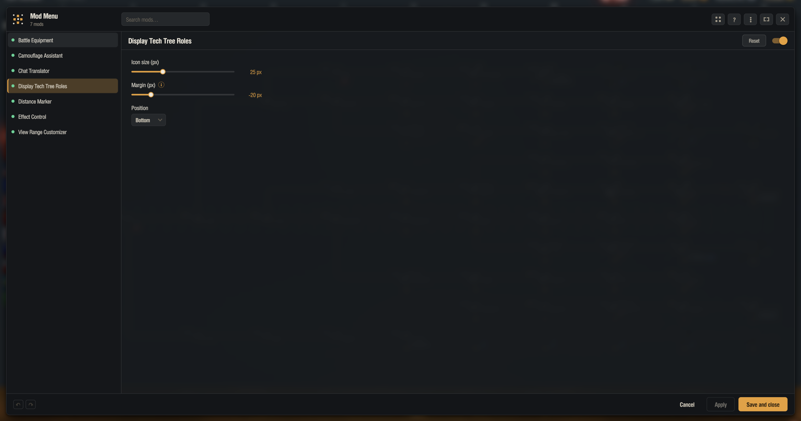

# Display Tech Tree Roles (DTTR)
Displays the game's vehicle role icons above or below vehicles in the tech tree. Vehicles without a defined role have no icon.

This mod comes in handy when choosing vehicles to use for mission requirements, as you no longer have to hover over each one!

## Showcase

Tech Tree Role Icons

Mod Menu Settings

## Settings
This mod uses Aslain's Mod Menu to provide an enabled switch, icon size, margin and Top/Bottom placement. Margin is measured from the vehicle image area, not the visible tank silhouette: positive values move the icon away, negative values overlap the area.

Changes apply to an open tech tree. Without the menu, built-in defaults are used.

## Information for modders
DTTR requires OpenWG Gameface 1.2.2 and a **World of Tanks** client with native `gui/gen_resources` mod registration (2.4.1 or later). The mod injects its own frontend into the tech-tree view; it does not replace the game bundle.

The injected renderer uses vehicle IDs and the tech-tree DOM structure, both of which should be checked after client updates. It observes native rerenders and releases its model callbacks, icons, and observer when the carrier is removed; the page-level listener remains until unload so a carrier can be reattached.

The Python configuration is in `src/displaytechtreeroles/config.py`, the Gameface view code is in `src/displaytechtreeroles/injection.py`, and game assets are in `src/res`. The internal mod name also determines the resource paths and injection feature name; changing it requires matching changes to the packaged resource declaration, asset directory, and JavaScript feature name.

To learn more about view-injection and hooking, visit the [modding documentation](https://modding.wot-tools.dev).