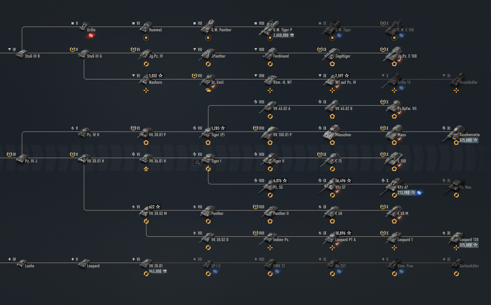

# Display Tech Tree Roles
Displays the game's vehicle role icons above or below vehicles in the tech tree. Vehicles without a defined role have no icon.

This mod comes in handy when choosing vehicles to use for mission requirements, as you no longer have to hover over each one!

### Settings
Aslain's Mod Menu provides an enabled switch, icon size (8–64 CSS px), margin (-32–32 CSS px), and Top/Bottom placement. The defaults are 25px, -20 px, and Bottom. Margin is measured from the vehicle image area, not the visible tank silhouette: positive values move the icon away, negative values overlap the area. 

Changes apply to an open tech tree. Without the menu, built-in defaults are used.

## Showcase

Tech Tree Role Icons

Mod Menu Settings

